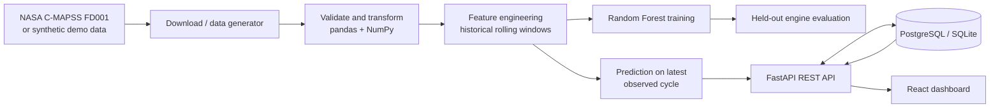

# AeroPulse — Industrial Intelligence & Predictive Maintenance

**A full-stack engineering portfolio project by Hamza Tarhouni**

AeroPulse is an end-to-end predictive-maintenance platform built around turbofan engine degradation data. It demonstrates how to move from raw sensor measurements to a repeatable data pipeline, a trained regression model, an API, a relational database, and an interactive web dashboard.

> **Important:** The default local demo uses generated synthetic data. The optional benchmark pipeline downloads NASA's public C-MAPSS FD001 dataset. C-MAPSS is a simulation benchmark; neither dataset represents live airline telemetry. AeroPulse is an educational portfolio prototype, not a certified aircraft maintenance or flight-safety system.

---

## Why this project exists

Maintenance teams need to understand asset condition before a failure occurs. AeroPulse explores one part of that problem: estimating an engine's **remaining useful life (RUL)** from its operating history and sensor measurements.

The user-facing product answers:

- Which monitored engines have the lowest predicted remaining useful life?
- How is the fleet distributed across risk bands?
- How have selected sensor readings changed over an engine's observed cycles?
- What model produced the estimate, and how was that model evaluated?

The point is not to claim that a beginner has solved aviation maintenance. The point is to show sound engineering habits: traceable data, a separated training/evaluation workflow, transparent thresholds, an API contract, automated tests, and honest model limitations.

## Product preview

Start with [`MENTOR_GUIDE.md`](MENTOR_GUIDE.md) for a four-week plan to understand and own the code, and [`CONTRIBUTING.md`](CONTRIBUTING.md) for project conventions.


The React dashboard includes:

- Fleet overview cards for monitored assets, critical engines, watchlist engines, and average predicted RUL.
- Fleet sensor trend and engine-risk distribution charts.
- A priority queue sorted by predicted remaining useful life.
- Search and risk filters for the engine fleet.
- Individual engine profiles with historical sensor charts and a latest-measurement snapshot.
- A model laboratory showing evaluation metrics, protocol, and limitations.
- CSV export of the current engine register.

## Technology

| Layer | Technology | Responsibility |
|---|---|---|
| Frontend | React, JavaScript, Vite | Interactive dashboard and asset views |
| Visualization | Recharts | Sensor trends and risk distribution |
| Backend | Python, FastAPI, Pydantic | REST endpoints and validation |
| Data processing | pandas, NumPy | Parsing, feature engineering, aggregation |
| Machine learning | scikit-learn, joblib | Random Forest RUL regression |
| Database | SQLite locally, PostgreSQL in Docker | Engine and observation persistence |
| Testing | pytest, FastAPI TestClient | Risk rules, features, and API contracts |
| Dev environment | Docker Compose | Repeatable local multi-service setup |
| CI | GitHub Actions | Backend tests and frontend build |

## Architecture



### Request flow

1. A user opens the dashboard.
2. React requests the overview, engine register, and model metrics from FastAPI.
3. FastAPI reads persisted records from SQLAlchemy.
4. The dashboard renders fleet metrics, risk categories, sensor trends, and engine profiles.
5. Selecting an engine requests its observation history from the API.

### Repository map

```text
aeropulse/
├── backend/
│   ├── app/
│   │   ├── data/                 # NASA download and benchmark pipeline
│   │   ├── ml/                   # Feature engineering and model training
│   │   ├── routers/              # FastAPI route modules
│   │   ├── services/             # Risk classification and analytics
│   │   ├── bootstrap_demo.py     # Generate and load demo data
│   │   ├── config.py
│   │   ├── database.py
│   │   ├── initialize.py
│   │   ├── main.py
│   │   └── models.py
│   ├── tests/
│   └── requirements.txt
├── frontend/
│   ├── src/
│   │   ├── App.jsx
│   │   ├── api.js
│   │   └── styles.css
│   ├── Dockerfile
│   └── package.json
├── .github/workflows/ci.yml
├── docker-compose.yml
└── README.md
```

---

## Run it locally (recommended first run)

You need Python 3.11+ and Node.js 20.19+ (Node 22 recommended).

### 1. Start the backend

Open a terminal:

```bash
cd backend
python -m venv .venv
```

Activate the environment:

**Windows PowerShell**

```powershell
.venv\Scripts\Activate.ps1
```

**macOS / Linux**

```bash
source .venv/bin/activate
```

Install dependencies and initialize the demo dataset:

```bash
python -m pip install --upgrade pip
pip install -r requirements.txt
python -m app.bootstrap_demo
```

Start the API:

```bash
uvicorn app.main:app --reload
```

The API is at `http://localhost:8000`.

- Interactive API documentation: `http://localhost:8000/docs`
- Health check: `http://localhost:8000/health`
- Fleet overview: `http://localhost:8000/api/overview`
- Engine register: `http://localhost:8000/api/engines`
- Model evaluation: `http://localhost:8000/api/model/metrics`

### 2. Start the frontend

Open a second terminal:

```bash
cd frontend
npm install
npm run dev
```

Open `http://localhost:5173`.

The frontend expects the API at `http://localhost:8000`. To change it, create `frontend/.env.local`:

```env
VITE_API_BASE_URL=http://localhost:8000
```

### 3. Run the automated tests

From the `backend` directory with the virtual environment activated:

```bash
python -m pytest -q
```

Build the frontend:

```bash
cd ../frontend
npm run build
```

---

## Use the public NASA benchmark

The repository includes small, deterministic CSV samples in `backend/data/` so you can inspect the row structure. They are generated synthetic examples, not downloaded NASA observations. The bootstrap script regenerates them and initializes the demo so the app can run without a large external download. To use the public C-MAPSS FD001 benchmark instead:

1. Stop the API process.
2. From the `backend` directory, download and extract the dataset.
3. Run the benchmark pipeline, which trains, evaluates, predicts, and replaces the currently loaded engine register.
4. Restart the API and refresh the dashboard.

```bash
cd backend
python -m app.data.download_nasa
python -m app.data.run_nasa_pipeline
uvicorn app.main:app --reload
```

The downloader uses NASA's published distribution URL. If that URL is unavailable from your network, set `CMAPSS_DATA_URL` to a trusted mirror URL before running the downloader.

### Data source and citation

- Dataset: [NASA Prognostics Center of Excellence — Turbofan Engine Degradation Simulation](https://www.nasa.gov/intelligent-systems-division/discovery-and-systems-health/pcoe/pcoe-data-set-repository/)
- Dataset mirror/catalogue: [PHM Society NASA repository](https://data.phmsociety.org/nasa/)
- Dataset paper: A. Saxena and K. Goebel (2008), *Turbofan Engine Degradation Simulation Data Set*, NASA Ames Research Center, Prognostics Center of Excellence.
- Download distribution listed by NASA: [CMAPSSData.zip](https://data.nasa.gov/docs/legacy/CMAPSSData.zip)

The C-MAPSS data consists of simulated run-to-failure engine trajectories. FD001 contains one operating condition and one fault mode. The rows have 26 numeric fields: engine/unit ID, cycle, three operating settings, and 21 sensor channels.

### What the benchmark pipeline does

- Reads `train_FD001.txt`, `test_FD001.txt`, and `RUL_FD001.txt`.
- Calculates training RUL from the end of each training trajectory and applies a 125-cycle cap.
- Builds historical rolling means and standard deviations for selected sensor channels.
- Fits a Random Forest regressor on training engines only.
- Predicts RUL at the final observed cycle of each held-out test engine.
- Calculates MAE, RMSE, and R² against the benchmark's test RUL targets.
- Loads the test trajectories and model predictions into the dashboard database.
- Keeps held-out ground-truth RUL values out of the operational engine records.

**Reproducibility note:** A model score depends on the feature choices, cap, split, and random seed. The metrics generated on your machine are the experiment result; do not copy a score into your CV without running the pipeline and retaining the result.

---

## API contract

| Method | Endpoint | Purpose |
|---|---|---|
| `GET` | `/health` | API health check |
| `GET` | `/api/overview` | Fleet totals, risk distribution, aggregate sensor trend |
| `GET` | `/api/engines` | Engine register with filters and sorting |
| `GET` | `/api/engines/{engine_id}` | One engine and its sensor observations |
| `GET` | `/api/model/metrics` | Evaluation metrics and experiment metadata |

Example queries:

```text
GET /api/engines?risk=critical&sort=predicted_rul&order=asc
GET /api/engines?search=SIM-04&limit=25
GET /api/engines/SIM-037
```

Risk bands are deliberately simple and transparent:

- `critical`: predicted RUL ≤ 20 cycles
- `watch`: predicted RUL 21–50 cycles
- `healthy`: predicted RUL > 50 cycles

Change the thresholds with `RISK_CRITICAL_CYCLES` and `RISK_WATCH_CYCLES`. These are demonstration labels, not regulatory maintenance thresholds.

---

## Publish your work on GitHub

Create an empty public repository named `aeropulse`, then run these commands from the project root (replace the remote URL with your own GitHub repository):

```bash
git init
git add .
git status
git commit -m "Build AeroPulse predictive maintenance platform"
git branch -M main
git remote add origin https://github.com/YOUR_USERNAME/aeropulse.git
git push -u origin main
```

Before pushing, inspect `git status` and confirm that no database, model artifact, downloaded raw dataset, `.env`, or credential file is staged. The GitHub Actions workflow runs backend tests and the frontend build on pushes and pull requests.

## Run the full stack with Docker

With Docker Desktop running, execute from the repository root:

```bash
docker compose up --build
```

- Frontend: `http://localhost:5173`
- API: `http://localhost:8000`
- API docs: `http://localhost:8000/docs`
- PostgreSQL: localhost port `5432` (container network only unless you publish it)

The API container initializes the synthetic demo dataset only when the database is empty. Once the NASA pipeline has populated the database, container restarts preserve it.

The credentials in `docker-compose.yml` are local-development credentials only. Replace them before deploying anywhere shared or public. Never commit production credentials.

---

## Engineering decisions worth discussing in an interview

### 1. Why predict RUL?

RUL regression creates a measurable ML task with a concrete decision context. It is more meaningful than presenting a model with no user or operational workflow.

### 2. Why a separate evaluation set of engines?

Rows from the same engine share trajectory-specific patterns. A random row split can leak information between training and evaluation. This project evaluates on held-out engine identities, a more defensible test of generalization to unseen engines.

### 3. Why rolling features?

A sensor's current value can be less informative than its recent behavior. Rolling means and standard deviations summarize local level and variability using only the current and previous observations.

### 4. Why persist observations?

Persistence separates ingestion and model inference from dashboard requests. The UI does not retrain a model every time a user opens a page; it reads the latest stored predictions and history.

### 5. Why keep the risk thresholds separate from the model?

The model estimates a number. The service layer converts that estimate into a transparent business-facing category. This makes policy thresholds easy to inspect and change without retraining the model.

### 6. Why call this a baseline?

A Random Forest is a sensible first model for tabular features, but it does not establish a production-grade prognostics system. Stronger work would compare baselines, validate across fault modes, calibrate uncertainty, track experiments, monitor data drift, and validate with domain experts.

---

## Next engineering milestones

These are deliberately ordered so the project grows through understandable increments:

1. **Data quality:** add schema validation, range checks, missing-value reports, and ingestion run metadata.
2. **Pipeline orchestration:** add a scheduled ingestion job and idempotent run IDs.
3. **Model comparison:** compare a naive baseline, linear regression, Random Forest, and gradient boosting using the same engine-level holdout.
4. **Explainability:** show sensor importance and local prediction explanations with clear caveats.
5. **Observability:** add structured logs, request IDs, and pipeline/model version tracking.
6. **Deployment:** publish a demo with a managed database, environment-based secrets, and CI deployment gates.
7. **Hardware extension:** add a small ESP32 or Raspberry Pi telemetry simulator and stream readings into a separate ingestion endpoint. Do not connect it to safety-critical machinery.

## Suggested CV / LinkedIn project description

Use this only after you have run the project, inspected the code, and can explain its trade-offs:

> **AeroPulse — Predictive Maintenance Intelligence Platform** — Built a full-stack data application using Python, FastAPI, React, SQLAlchemy, and scikit-learn. Developed a reproducible sensor-data pipeline and a Random Forest baseline to estimate remaining useful life from engine degradation trajectories; evaluated on held-out engine IDs and exposed fleet analytics, risk filtering, and sensor histories through a REST API and interactive dashboard. Containerized the stack with Docker Compose and added automated backend tests and frontend build checks.

## How to present this project in an interview

Do not lead with “I used AI to build it.” Lead with the engineering decisions:

1. Explain the maintenance problem and who needs the result.
2. Draw the raw-data-to-dashboard architecture.
3. Explain why the test split is by engine rather than by row.
4. Show the API contract and database schema.
5. Show a test that prevents future-data leakage in rolling features.
6. Explain the model's errors and what you would improve next.
7. Be explicit about what you built, what AI assisted with, and what you personally verified.

A hiring manager will be more impressed by a candidate who can defend a small, well-tested system than one who presents a large codebase they cannot explain.

---

## License

Application code: MIT. Dataset rights and terms remain with their respective source and contributors; cite the NASA/PCoE dataset when using it.
